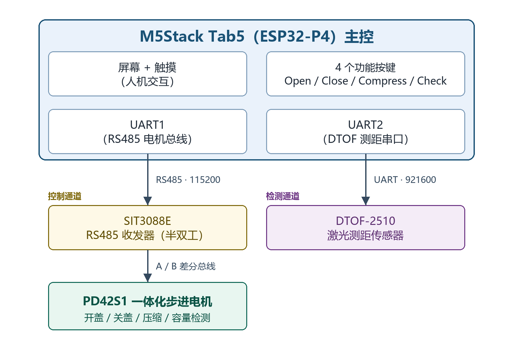

# 基于M5Stack的智能垃圾桶控制系统设计

摘要：针对垃圾桶开盖、垃圾压缩、容量检测与免接触操作的应用需求，设计了一种以 M5Stack Tab5 为主控、正点原子 PD42S1 智能步进电机为执行机构的智能垃圾桶控制系统。系统通过 RS485 总线驱动步进电机，实现桶盖的自动开关、垃圾压缩与容量检测；采用 DTOF-2510 激光测距传感器实现免接触的自动开关盖。

方案设计方面，依据功能需求将系统划分为电机控制、距离检测、容量检测与人机交互四个模块，并对各模块的实现方式进行比较选型。电机控制未采用开环脉冲控制，而是利用 PD42S1 内置驱动的绝对位置模式与力矩模式，分别完成开关盖的定位与压缩/检测的恒力矩下压；免接触操作通过测距阈值与延时计时相结合，实现"靠近自动开盖、离开延时关盖"的控制逻辑。

硬件部分以 M5Stack Tab5 为核心，板载 SIT3088E 半双工 RS485 收发器用于电机通信，DTOF-2510 经独立 UART 接入，距离检测与电机控制两条链路相互隔离。软件部分运行于 UIFlow2.0（MicroPython），采用单线程主循环加任务状态机的结构，实现了 RS485 协议组帧与解析、DTOF-2510 ASCII 数据流解析、静止判断与容量换算、自动开关盖的下降沿触发与延时控制，并配置通信看门狗与任务超时保护。

关键词：智能垃圾桶；步进电机；RS485；DTOF 激光测距；自动开关盖

# 第1章 设计任务与方案确定

## 1.1 设计任务

智能垃圾桶是嵌入式系统在智能家居领域的典型应用。本课题以 M5Stack Tab5 为控制核心，通过 RS485 总线驱动 PD42S1 智能步进电机，实现桶盖的开关、垃圾压缩与容量检测，并通过激光测距传感器实现免接触的自动开关盖。

系统需实现的功能为：电机带动桶盖在开盖位置与关盖位置之间运动；压缩与容量检测时电机以恒力矩持续下压；实时显示桶盖状态、容量百分比与桶内距离；当手接近到设定距离内时自动开盖，离开后延时自动关盖。任务书规定的技术指标如表 1-1 所示。

| 项目 | 指标 | 实现方式 |
|------|------|----------|
| 开盖位置 | 37000 脉冲 | 绝对位置模式（0xF2） |
| 关盖位置 | 25000 脉冲 | 绝对位置模式（0xF2） |
| 开关盖速度 | 10 RPM | 速度参数 |
| 加减速 | 150（0~200） | 加减速参数 |
| 压缩力矩 | 600 mA | 力矩模式（0xF0） |
| 容量检测范围 | 0%~100% | 位置 25000→13000 线性换算 |
| 测距范围 | 20~10000 mm | DTOF-2510 |
| 自动开盖阈值 | 200 mm | 下降沿触发 |
| 自动关盖延时 | 3 s | 计时触发 |
| RS485 波特率 | 115200 | UART1 |
| 测距波特率 | 921600 | UART2 |
| 通信看门狗 | 5 s 无应答报警 | COMM_TIMEOUT_MS |
| 任务超时 | 60 s | TASK_TIMEOUT_MS |

表 1-1 设计技术指标

## 1.2 总体设计思路

任务书给出了自动开盖阈值、自动关盖延时、容量检测范围等指标，这几项构成设计约束，其余参数在此基础上确定。

整机划分为控制通道与两条通信链路：主控经 RS485 半双工总线控制电机，经独立 UART 接收测距传感器数据，两条链路相互独立、互不干扰；人机交互通过屏幕与四个功能按键完成。

器件选型以模块化、易于调试为原则，主控、电机、测距与控制策略各确定一种方案。

实施过程按硬件连接、软件设计、系统联调的顺序展开。

## 1.3 方案确定

主控在 STM32、ESP32 与 M5Stack Tab5 之间比较：STM32 需自行搭建显示、触摸与电源电路，工作量集中在非核心部分；裸 ESP32 开发板缺少成熟的图形框架。M5Stack Tab5 以 ESP32-P4（双核 RISC-V）为核心，集成屏幕、触摸、RS485 收发器与多路 UART，运行 UIFlow2.0（MicroPython）可直接使用图形与串口接口，故选用该型号。

电机在普通步进电机加独立驱动器与智能一体化步进电机之间比较：前者需分别配置驱动器、脉冲、方向与使能信号；PD42S1 为内置驱动的一体化步进电机，仅需一路 RS485 即可实现绝对位置、力矩、速度等多种控制模式，接线少、便于调试，故选用该型号。

测距在红外对射、超声波与激光测距之间比较：红外对射只能判断有无、无法测距；超声波近距离盲区较大且易受桶壁反射干扰。DTOF-2510 为直接飞行时间激光测距传感器，量程 20~10000 mm，以 ASCII 文本主动上报距离与置信度，故选用该型号。

免接触控制采用"测距阈值 + 延时计时"方案：当测距进入开盖阈值以内时触发开盖，离开后经延时自动关盖。相比连续位置跟踪，该方案逻辑简单、状态明确，抗抖动能力强。

方案确定后，系统总体结构如图 1-1 所示。



图 1-1 系统总体框图

# 第2章 硬件设计

## 2.1 系统组成与供电

整机分为控制通道与两条通信链路：主控经 RS485 半双工总线控制电机，经独立 UART 接收测距传感器数据。

系统由 M5Stack Tab5 统一供电。Tab5 板载 SIT3088E 半双工 RS485 收发器，经 DE/RE 方向引脚控制收发切换；电机 PD42S1 由独立电源供电，其 RS485 的 A、B 线接入 Tab5 的 RS485 接口；DTOF-2510 经 M5-Bus 的 UART 引脚接入。系统组成如表 2-1 所示。

| 网络 | 来源 | 供给对象 | 说明 |
|------|------|----------|------|
| 主控供电 | Tab5 内置 | 主控、屏幕、RS485 收发器 | 板载电源管理 |
| 电机供电 | 独立电源 | PD42S1 电机 | 与主控电气隔离 |
| 传感器供电 | Tab5 M5-Bus | DTOF-2510 | 3.3V 供电 |
| GND | 公共 | 全部 | 电机侧与主控侧共地 |

表 2-1 系统组成与供电

## 2.2 主控模块与引脚分配

M5Stack Tab5 以 ESP32-P4 为主控，板载屏幕、触摸与 RS485 收发器。RS485 收发器占用一路 UART 与一个方向控制引脚，DTOF-2510 占用另一路 UART。引脚分配见表 2-2。

| 引脚 | 功能 | 连接到 | 说明 |
|------|------|--------|------|
| GPIO20 | UART1_TX | RS485 TXD | 电机通信发送 |
| GPIO21 | UART1_RX | RS485 RXD | 电机通信接收 |
| GPIO34 | DIR | RS485 DE/RE | 半双工方向控制 |
| GPIO37 | UART2_TX | DTOF-2510 TXD | 测距传感器 |
| GPIO38 | UART2_RX | DTOF-2510 RXD | 测距传感器 |

表 2-2 引脚分配

RS485 采用 UART1（115200、8N1），方向引脚 GPIO34 控制 SIT3088E 的发送/接收使能；DTOF-2510 采用 UART2（921600、8N1），两路串口独立，避免电机应答与测距数据相互干扰。

## 2.3 电机驱动与 RS485 通信

电机 PD42S1 为内置驱动的一体化步进电机，从机地址 0x01，经 RS485 半双工总线与主控通信。RS485 收发器为 SIT3088E，DE/RE 由 GPIO34 控制。

半双工发送时序为：置高方向引脚（进入发送态）→ 延时 200 μs 建立 DE → 写入数据并等待末字节上线 → 置低方向引脚（切回接收态）→ 延时 50 ms 命令间隔。关键点在于末字节上线后必须及时释放总线，否则电机应答会与本机发送器冲突。

通信帧结构为"帧头 0xC5 + 从机地址 + 功能码 + 数据 + 校验和 + 帧尾 0x5C"，校验和为数据段累加和的低 8 位。控制帧包括绝对位置模式（0xF2）、力矩模式（0xF0）、使能（0xFA）、停止（0xFC）、清除状态（0xFB）；读取帧包括位置（0x2A）、堵转标志（0x2D）、到位标志（0x30）。

## 2.4 测距传感器接口

DTOF-2510 经 UART2 接入主控，波特率 921600。传感器主动上报 ASCII 文本行，每行以换行符结尾，格式为"距离,置信度"，距离单位为毫米、置信度为 0~1000 的整数，例如"123.4,88"表示距离 123.4 mm、置信度 88。

传感器与电机分属两路独立 UART，互不占用带宽；DTOF-2510 初始化失败时仅降级处理，不影响电机控制。

## 2.5 交互接口

人机交互由 Tab5 屏幕与四个功能按键完成。屏幕显示桶盖状态、容量百分比与测距距离三行信息；四个按键分别对应开盖（Open）、关盖（Close）、压缩（Compress）与容量检测（Check），组成 2×2 布局。界面固定为英文，因所用 Montserrat 字体不含中文字形。

## 2.6 系统连接与元件清单

系统接线为：Tab5 的 GPIO20/21 经板载 RS485 收发器接电机 A、B 线，GPIO34 接方向控制；GPIO37/38 接 DTOF-2510。元件清单如表 2-3 所示。

| 元件 | 型号 | 作用 |
|------|------|------|
| 主控 | M5Stack Tab5（ESP32-P4） | 控制核心、人机交互 |
| 步进电机 | 正点原子 PD42S1 | 开关盖、压缩执行 |
| RS485 收发器 | SIT3088E | 电机通信（板载） |
| 测距传感器 | DTOF-2510 | 免接触检测 |

表 2-3 元件清单

# 第3章 软件设计

## 3.1 程序结构与任务划分

程序没有使用操作系统，而是采用单线程主循环加任务状态机的结构：setup() 完成初始化，loop() 每 10 ms 轮询一次，按顺序处理串口收发、待执行任务、任务状态机推进与测距轮询。

程序按功能划分为六个模块，各模块对外仅提供少量接口，如表 3-1 所示。

| 模块 | 文件 | 职责 |
|------|------|------|
| 主程序 | main.py | 初始化、主循环调度 |
| RS485 协议 | main.py | 组帧、校验、应答解析 |
| 电机控制 | main.py | 绝对位置/力矩模式、静止判断 |
| 测距解析 | SensorParser | DTOF-2510 ASCII 数据流解析 |
| 任务状态机 | main.py | 任务登记、推进、异常保护 |
| 用户界面 | m5ui | 屏幕布局、状态刷新 |

表 3-1 程序模块划分

## 3.2 测距数据解析

DTOF-2510 以 ASCII 文本行主动上报数据。SensorParser 类将字节流累积到缓冲区，按换行符切行，取逗号前的距离字段并四舍五入为整数毫米，越界（小于 20 或大于 10000）则丢弃。每次轮询排空缓冲区中所有完整帧，只保留最新一帧距离，避免缓冲区累积。

## 3.3 自动开关盖控制

自动开关盖采用"测距阈值 + 延时计时"的下降沿触发逻辑。当距离进入开盖阈值（200 mm）以内时，由"远离"到"靠近"的下降沿触发开盖；当距离离开阈值后启动计时，超过延时（3 s）自动关盖；计时期间物体重新进入范围则取消计时。

该逻辑仅当无任务运行时才会触发，避免打断正在进行的开关盖、压缩或容量检测；下降沿触发避免了物体停留在阈值内时反复触发。

## 3.4 电机控制

开关盖采用绝对位置模式（0xF2）：先清除旧状态并设置位置环最大电流，再下发目标位置；完成判定采用与容量检测相同的静止判断——位置在观测窗口内停止变化且落在目标容差内即视为到位。

压缩与容量检测采用力矩模式（0xF0）：电机以 600 mA 持续下压且不主动抱闸，由开关盖指令退出。容量检测每 200 ms 采样一次位置，当最近 5 个样本的最大最小值之差小于 10 个脉冲时判定静止，再按"位置 25000 对应 0%、13000 对应 100%"线性换算为容量百分比。

## 3.5 人机交互

界面分为桶盖状态、容量百分比与测距距离三行显示；四个功能按键通过回调登记待执行任务，由主循环统一执行，避免在图形事件回调中直接发送指令。按钮按下仅当无任务运行时才被接受，防止误触发。

## 3.6 故障处理

系统配置两类保护：通信看门狗在任务运行期间监测电机应答，超过 5 s 无应答即停止并报警；任务超时在超过 60 s 时强制停止并清除状态。静止但远离目标位置时判定为卡阻，同样触发保护。异常时发送立即停止与清除状态指令，并将界面状态置为错误提示。

# 第4章 调试与结果

## 4.1 调试环境与调试方法

软件在 UIFlow2.0 的 Python 模式下运行，串口调试经 M5Stack 的调试串口打印原始收发字节与解析结果。硬件调试分三步：先只接主控不上电电机，确认界面与测距显示正常；再单独观测 RS485 总线的发送帧与应答帧；最后接入电机带负载，观测开关盖与压缩动作。

## 4.2 RS485 命令回显语义反转

电机通信时出现"电机无应答"报警，但 RS485 接线与地址均正确。经对照 STM32 例程发现，本电机单元的 0x6F（命令回显）指令语义与例程注释相反：数据 0 为开启回显、数据 1 为关闭；且关闭状态掉电后仍保持。原代码未在每次上电时重新开启回显，导致通信看门狗误报。修复后在初始化阶段每次上电都重新发送回显开启指令，问题解决。

## 4.3 测距传感器协议不匹配

测距传感器接入后始终无有效读数。原代码按 TFmini/TF-Luna 的二进制帧（帧头 0x59 0x59）解析，而实际选用的 DTOF-2510 以 ASCII 文本行"距离,置信度"主动上报，二者协议完全不同。查阅传感器参考例程确认输出格式后，重写 SensorParser 为按换行符切行、按逗号取距离字段，并将波特率由 115200 改为 921600，测距恢复正常。

## 4.4 传感器缓冲区累积

测距显示偶尔滞后且内存占用缓慢上升。原轮询函数每次仅解析一帧，而传感器以约 100 Hz 持续上报，导致缓冲区中未消费的帧不断累积。修复为每次轮询排空所有完整帧、仅保留最新一帧，缓冲区不再增长，显示恢复实时。

## 4.5 运行结果与分析

上电后界面显示桶盖状态、容量百分比与测距距离。手靠近到 200 mm 以内时桶盖自动打开，界面显示 Opening... 随后变为 Opened；手离开约 3 s 后自动关闭。按键功能正常：按 Open/Close 分别开盖、关盖，按 Compress 电机持续下压压缩垃圾，按 Check 下压至静止后显示容量百分比。

拔下测距传感器后距离显示保持占位符，电机控制不受影响；拔下电机 RS485 总线后，任务运行 5 s 内触发无应答报警并停止电机。

# 第5章 总结

## 5.1 完成的主要工作

本文完成了基于 M5Stack Tab5 的智能垃圾桶控制系统。硬件以 Tab5 为核心，经 RS485 总线驱动 PD42S1 步进电机，经独立 UART 接入 DTOF-2510 激光测距传感器。软件实现了 RS485 协议组帧与解析、绝对位置与力矩两种电机控制模式、DTOF-2510 ASCII 数据流解析、静止判断与容量换算、自动开关盖的下降沿触发与延时控制，并配置通信看门狗与任务超时保护。调试中解决了命令回显语义反转、测距协议不匹配、传感器缓冲区累积三个问题。

## 5.2 指标达成情况

对照表 1-1 所列指标，开关盖定位、压缩力矩、容量检测范围、测距范围、自动开盖阈值、自动关盖延时、通信看门狗与任务超时等指标均已实现，并在实物上得到验证。

## 5.3 存在的不足与改进方向

容量检测依赖电机下压至静止后的位置，对垃圾的松紧程度敏感，代表性有限。改进方向是结合测距传感器对桶内高度进行冗余测量，与电机位置相互校验，提高容量估算的鲁棒性。此外，自动开关盖目前仅靠单点距离阈值，可进一步引入持续跟踪与手势识别。

# 参考文献

[1] 王晓明. 电动机的单片机控制[M]. 4版. 北京: 北京航空航天大学出版社, 2016.
[2] 陈维刚. 智能控制技术[M]. 北京: 机械工业出版社, 2019.
[3] 郭天祥. 新概念51单片机C语言教程[M]. 2版. 北京: 电子工业出版社, 2018.
[4] 张毅, 王俊. 基于RS485总线的一体化步进电机控制系统设计[J]. 微电机, 2018, 51(6): 74-77.
[5] 刘军, 李伟. 基于ToF激光测距的智能垃圾桶设计[J]. 传感器与微系统, 2020, 39(8): 102-104.
[6] 陈忠, 赵敏. 基于STM32的智能垃圾桶控制系统设计[J]. 自动化与仪表, 2019, 34(5): 55-58.

# 附录

## 附录1 系统连接图

图附-1 智能垃圾桶系统连接图（Tab5 经 RS485 接 PD42S1，经 UART 接 DTOF-2510）

## 附录2 核心源代码

```python
# ===================== 协议常量 =====================
_FHEAD     = 0xC5    # 帧头
_FTAIL     = 0x5C    # 帧尾
_F_POS     = 0xF2    # 绝对位置模式运动
_F_TORQUE  = 0xF0    # 力矩模式运动
_F_EN      = 0xFA    # 电机使能
_F_STOP    = 0xFC    # 立即停止
_F_CLEAR   = 0xFB    # 清除状态
_F_RD_POS  = 0x2A    # 读实时位置
_F_RD_CLOG = 0x2D    # 读堵转标志
_F_RD_ARV  = 0x30    # 读到位标志

ADDR = 0x01          # 电机从机地址

# ===================== 运动参数 =====================
SPEED = 10           # 速度 (RPM)
ACC   = 150          # 加减速
POS_OPEN  = 37000    # 开盖绝对位置
POS_CLOSE = 25000    # 关盖绝对位置
TORQUE_MA = 600      # 压缩/检测力矩 (mA)
POS_FULL  = 13000    # 100% 容量位置
POS_EMPTY = 25000    # 0% 容量位置

AUTO_OPEN_MM  = 200     # 自动开盖阈值 (20cm)
AUTO_CLOSE_MS = 3000    # 自动关盖延时 (3s)

# ===================== 校验与组帧 =====================
def _checksum(data):
    s = 0
    for b in data:
        s += b
    return s & 0xFF

def _build_pos(addr, direction, acc, speed, pulses):
    """绝对位置运动帧 (14 字节, 0xF2)"""
    b = bytearray(14)
    b[0] = _FHEAD
    b[1] = addr
    b[2] = _F_POS
    b[3] = direction
    b[4] = acc
    b[5] = (speed >> 8) & 0xFF
    b[6] = speed & 0xFF
    b[7] = (pulses >> 24) & 0xFF
    b[8] = (pulses >> 16) & 0xFF
    b[9] = (pulses >> 8) & 0xFF
    b[10] = pulses & 0xFF
    b[11] = 0
    b[12] = _checksum(b[:12])
    b[13] = _FTAIL
    return b

def _build_torque(addr, direction, ma):
    """力矩运动帧 (8 字节, 0xF0)"""
    b = bytearray(8)
    b[0] = _FHEAD
    b[1] = addr
    b[2] = _F_TORQUE
    b[3] = direction
    b[4] = (ma >> 8) & 0xFF
    b[5] = ma & 0xFF
    b[6] = _checksum(b[:6])
    b[7] = _FTAIL
    return b

# ===================== 测距解析 (DTOF-2510) =====================
class SensorParser:
    """DTOF-2510: ASCII 行 '距离,置信度\n'，距离单位 mm"""
    def __init__(self):
        self.buf = bytearray()

    def feed(self, data):
        self.buf.extend(data)

    def parse(self):
        while True:
            i = self.buf.find(b'\n')
            if i < 0:
                if len(self.buf) > 64:
                    self.buf = bytearray()
                return None
            line = bytes(self.buf[:i])
            self.buf = self.buf[i + 1:]
            j = line.find(b',')
            if j <= 0:
                continue
            try:
                dist_mm = int(float(line[:j].decode().strip()) + 0.5)
            except ValueError:
                continue
            if dist_mm < 20 or dist_mm > 10000:
                continue
            return dist_mm
```

## 附录3 实物照片

图附-2 整机运行实物照片
